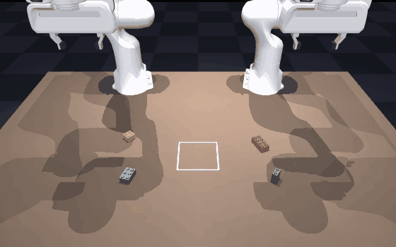
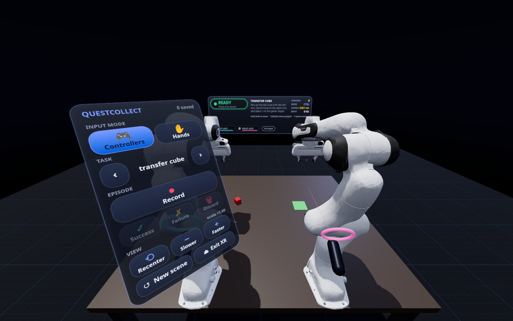
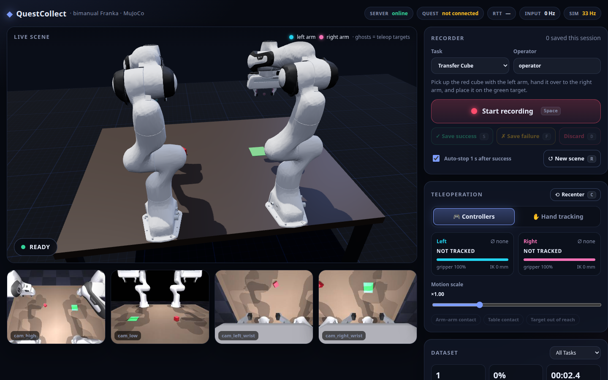
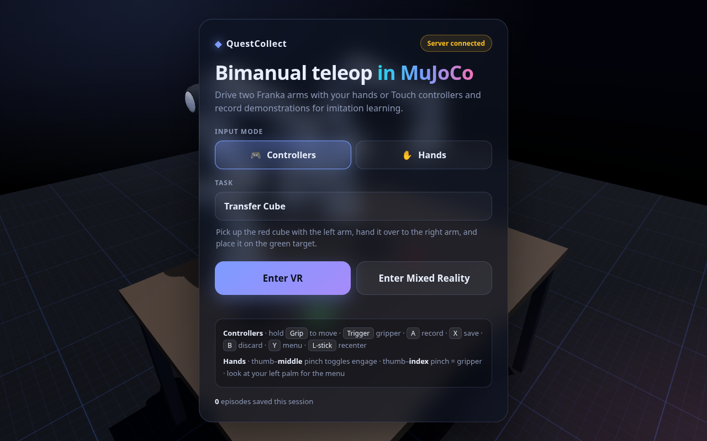
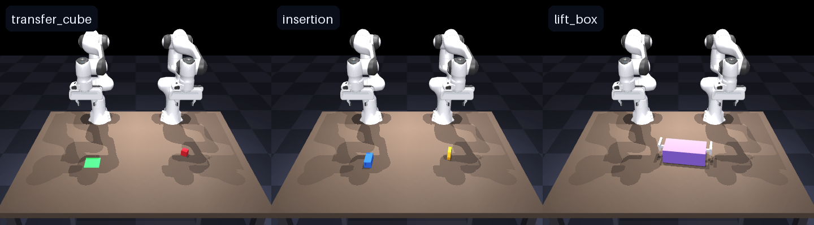
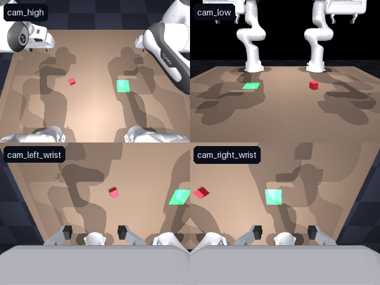

# QuestCollect

**Teleoperate two simulated Franka Panda arms with a Meta Quest 3 and record demonstrations for imitation learning.**


<p align="center">
  
  <br><sub>The <code>transfer_cube</code> task. This clip is scripted (<a href="scripts/make_media.py">scripts/make_media.py</a>) but drives the same IK and control stack as the headset.</sub>
</p>

<table>
  <tr>
    <td width="50%"></td>
    <td width="50%"></td>
  </tr>
  <tr>
    <td align="center"><sub><b>In the headset:</b> wrist menu, HUD, controller and arm-target ghost</sub></td>
    <td align="center"><sub><b>On the PC:</b> live 3D view, 4 camera feeds, recorder, dataset browser</sub></td>
  </tr>
</table>

## What it does

You put on a Quest 3, open a web page in the Quest Browser and see the MuJoCo scene in stereo VR or mixed reality. Your
controllers or tracked hands move the two robot arms. Every episode you record is saved losslessly (full sim state, raw
hand poses, actions) and can be exported as a [LeRobot](https://github.com/huggingface/lerobot) dataset to train ACT,
Diffusion Policy, π0, SmolVLA and similar policies.

- **Nothing to install on the headset.** It's a WebXR page served by your PC.
- **Controllers or hand tracking**, switchable at runtime.
- **Clutch-style control:** hold Grip (or pinch) to move an arm, release to reposition your hand, like lifting a mouse.
- **Three bimanual tasks** with randomized resets and automatic success detection.
- **Exact replay:** episodes store the MuJoCo state, so cameras can be re-rendered later at any resolution.

```text
Quest 3 ─ Quest Browser (WebXR, three.js)                      PC ─ Python 3.12
  head + 2×(controller pose/buttons | 25 hand joints) ─ws──▶ teleop (clutch, filters)
  renders MuJoCo mirror  ◀── body poses @50 Hz ─────────── mink IK (both arms, one QP)
  HUD / wrist menu       ◀── status + events ─────────────  MuJoCo 500 Hz physics
                                                             recorder → HDF5 → LeRobot
Desktop browser ─ dashboard (React) ◀──────────────────────  FastAPI (http :8000, https :8443)
```

## Requirements

| | |
|---|---|
| **OS** | Linux (developed on Ubuntu). A GPU with EGL is recommended for camera rendering. |
| **[uv](https://docs.astral.sh/uv/)** | Python package manager. It installs Python 3.12 for you. |
| **Node.js ≥ 20** | Only to build the web client once. |
| **git** | To download the robot model. |
| **Meta Quest 3** | Optional for trying things out. You can view the scene and the dashboard without one. |
| **adb** | For the USB connection to the headset (`sudo apt install android-tools-adb`). |
| **openssl** | Only for the Wi-Fi connection (usually preinstalled). |

<details>
<summary>Installing uv and Node.js</summary>

```bash
curl -LsSf https://astral.sh/uv/install.sh | sh          # uv
curl -o- https://raw.githubusercontent.com/nvm-sh/nvm/v0.40.1/install.sh | bash && nvm install 22   # Node via nvm
```
</details>

## Installation

```bash
git clone <this-repo-url> questcollect
cd questcollect

./scripts/fetch_assets.sh              # 1. Franka Panda model from mujoco_menagerie (sparse clone)
uv sync                                # 2. Python 3.12 venv + dependencies
(cd web && npm ci && npm run build)    # 3. build the headset page and the dashboard
uv run qc doctor                       # 4. check that everything is in place
```

`qc doctor` prints a ✓/✗ list (robot model, offscreen rendering, web build, adb, headset, TLS cert) with a hint next to
anything that's missing. adb, the headset and the certificate are only needed for the later steps.

## Running

### 1. Start the server

```bash
uv run qc serve
```

Keep this terminal open. Open **<http://localhost:8000/dashboard/>** on the PC: you should see both arms, four camera
feeds and the recorder. No headset yet? Everything below works from the dashboard, and `uv run qc view` opens the scene
in MuJoCo's own viewer.

### 2. Connect the Quest 3

WebXR only runs on `http://localhost` or `https://`, so pick one of these:

#### USB cable (recommended: lowest latency, no certificates)

1. *First time only:* in the Meta Horizon phone app, open your headset's settings and turn on **Developer Mode**.
2. Plug the headset into the PC, put it on and accept **Allow USB debugging**.
3. On the PC, in a second terminal:

   ```bash
   uv run qc setup-quest     # adb reverse: the headset's localhost:8000 → this PC
   ```

4. In the **Quest Browser**, open `http://localhost:8000/xr/` and press **Enter VR** (or **Enter Mixed Reality** for passthrough).

Run `qc setup-quest` again whenever you replug the cable or reboot the headset.

#### Wi-Fi

```bash
uv run qc certs     # once: self-signed certificate for your LAN IP
uv run qc serve     # restart: now also serves https on port 8443
```

The server prints the address. Open `https://<pc-ip>:8443/xr/` in the Quest Browser and accept the certificate
warning once (Advanced → Proceed). Use 5/6 GHz Wi-Fi, ideally with the PC on Ethernet.

**Hand tracking:** on the headset, turn on Settings → Movement tracking → **Hand and body tracking**.

<p align="center"><br>
<sub>What you see in the Quest Browser before entering VR</sub></p>

### 3. Record demonstrations

When you enter VR, the virtual table is placed in front of you automatically. Hold **Grip** to take control of an
arm and move. The translucent **ghost gripper** shows where the arm is being sent (cyan = left, pink = right).

| | Controllers | Hands |
|---|---|---|
| Move an arm | hold **Grip** and move | **thumb + middle** pinch toggles control |
| Gripper | **Trigger** (analog) | **thumb + index** distance (analog) |
| Record / stop | **A** | wrist menu |
| Save as success | **X** | wrist menu |
| Discard | **B** | wrist menu |
| Menu | **Y** | turn your **left palm** toward your face |
| Recenter the table | **left stick click** | wrist menu |

**Dashboard keyboard:** `Space` record/stop · `S` save success · `F` save failure · `D` discard · `R` new scene · `C` recenter.

A take goes **ready → 3 s countdown → recording → review → save or discard**. Recording also stops by itself one second
after the task's success check passes. After saving, the scene re-randomizes for the next take.

Episodes are saved to `data/raw/<task>/episode_XXXXXX.hdf5`.

```bash
uv run qc inspect data/raw/transfer_cube/episode_000000.hdf5   # metadata + array shapes
uv run qc replay  data/raw/transfer_cube/episode_000000.hdf5   # play back in the MuJoCo viewer
```

You can also replay from the dashboard's dataset list (▶). The replay is mirrored into the headset.

### 4. Export for training

```bash
uv sync --extra export
uv run qc export lerobot --out data/lerobot/transfer_cube --task transfer_cube
#   --action ee          end-effector state/action instead of joints
#   --height 480 --width 640
#   --include-failures   also export episodes saved as failures
```

## Tasks



| Task | Goal |
|---|---|
| `transfer_cube` | The left arm picks up the red cube, hands it to the right arm, which places it on the green target. |
| `insertion` | ALOHA-style: lift the peg (left) and the socket (right), then insert the peg in mid-air. |
| `lift_box` | Grasp both handles and lift the box level, at least 15 cm. |

Pick the task in the dashboard, the wrist menu, or at startup with `uv run qc serve --task insertion --mode hands`.
To add a task, copy one of the files in [questcollect/sim/tasks/](questcollect/sim/tasks/).

## What gets recorded

One HDF5 file per episode, at the 50 Hz control rate. The full schema is in
[questcollect/record/schema.py](questcollect/record/schema.py).

| Group | Contents |
|---|---|
| `obs/*` | joint positions/velocities (14), gripper widths (2), gripper poses (2×7), task object poses |
| `action/joint_pos` | **[7 left joints, left grip, 7 right joints, right grip]**: the ALOHA/ACT convention (grip 0 = closed, 1 = open) |
| `action/ee_pose` | IK targets: 2 × (xyz + quaternion wxyz) + 2 grippers |
| `sim/state` | full MuJoCo state per step, for **exact replay and re-rendering** |
| `teleop/*` | head pose, raw controller poses/buttons or 25-joint hand poses, engaged/tracked flags, latency |
| attributes | task, language instruction, operator, input mode, success, seed, fps, full scene XML, config |

Camera images are not stored while recording. The exporter re-renders them from `sim/state`, so you can choose the
resolution afterwards. These are the four cameras, named as in ALOHA so existing ACT configs map directly:



The LeRobot dataset contains `observation.state` (16), `action` (16), `observation.images.<camera>` (video),
`observation.environment_state` (single-task datasets) and the task instruction as the language prompt.

## Configuration

All settings are in [config/default.yaml](config/default.yaml): control/physics rates, motion scale, filtering,
workspace limits, IK weights, cameras, output folder and ports. Pass another file with `uv run qc serve --config my.yaml`.

## Troubleshooting

| Problem | Fix |
|---|---|
| **Enter VR** is greyed out | You're not in the Quest Browser, or the URL isn't `http://localhost` / `https://`. Re-run `qc setup-quest` after replugging. |
| `qc setup-quest` says *no device* or *unauthorized* | Turn on Developer Mode, put the headset on and accept the USB debugging prompt. |
| No camera previews, or `qc doctor` fails rendering | Check the NVIDIA EGL drivers, or try `MUJOCO_GL=osmesa uv run qc serve`. |
| The arm doesn't move | Look for a *mode mismatch* (hands mode while holding controllers, or the reverse) or *Out of reach* on the HUD/dashboard. |
| High latency on Wi-Fi | Use the USB cable, or move closer to a 5/6 GHz access point. |

## Development

```bash
uv run --group dev pytest        # unit + integration tests
cd web && npm run dev            # hot-reloading web client on :5173 (proxies the Python server)
```

**Testing without a headset.** Load `/xr/` in desktop Chrome with Meta's
[Immersive Web Emulator](https://chromewebstore.google.com/detail/immersive-web-emulator/cgffilbpcibhmcfbgggfhfolhkfbhmik),
or run the automated end-to-end test [web/e2e/emulated-quest.mjs](web/e2e/emulated-quest.mjs). It drives an emulated
Quest 3 in headless Chromium against a running server and checks the controller and hand pipelines, the clutch, the
gripper, axis mapping, the record/save flow and mode-mismatch warnings. Setup is at the top of the file.

**Regenerating the README media:**

```bash
MUJOCO_GL=egl uv run python scripts/make_media.py   # demo.gif, tasks.png, cameras.png
cd web/e2e && npm run screenshots                   # dashboard + headset screenshots (server must be running)
```

<details>
<summary>Code layout</summary>

```text
questcollect/
  sim/        scene.py (MjSpec bimanual scene) · env.py · tasks/ · scene_export.py (→ three.js)
  ik/         solver.py (mink: 2 frame tasks + posture + joint/velocity limits + arm-arm collision avoidance)
  teleop/     frames.py (XR↔MuJoCo) · filters.py (One-Euro) · arm_mapper.py (clutch) · controller/hand mappers · teleop.py
  record/     recorder.py (state machine) · hdf5_io.py · render.py · schema.py
  export/     to_lerobot.py
  server/     app.py (FastAPI + websockets) · protocol.py (binary wire format, mirrored in web/src/protocol.ts)
  runtime.py  real-time sim thread (input → teleop → IK → physics → record → publish)
  cli.py      qc serve | view | replay | inspect | export | setup-quest | certs | doctor
web/src/
  scene/MujocoScene.ts   rebuilds the MuJoCo scene in three.js (shared by headset + dashboard)
  xr/                    WebXR app: input sampling, hand/controller visuals, HUD, wrist menu
  dashboard/             React dashboard
config/default.yaml      all tunable settings
scripts/                 fetch_assets.sh · make_media.py
```
</details>

## Acknowledgements

- Franka Emika Panda model from [MuJoCo Menagerie](https://github.com/google-deepmind/mujoco_menagerie) (Apache-2.0), downloaded by `scripts/fetch_assets.sh`.
- [mink](https://github.com/kevinzakka/mink) for differential IK, [three.js](https://threejs.org/) for rendering, Meta's [IWER](https://github.com/meta-quest/immersive-web-emulation-runtime) for headset-free testing.
