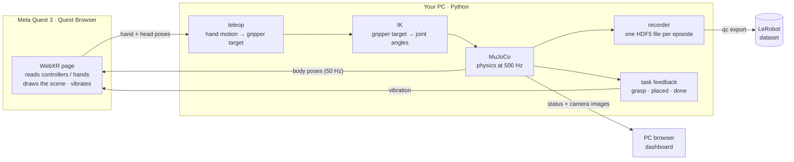

# QuestCollect

**Control two simulated robot arms with a Meta Quest 3, build a DUPLO tower, and record every attempt as training
data for robot learning.**


<p align="center">
  
  <br><sub>Two Franka Panda arms build the tower. This clip is scripted by
  <a href="scripts/make_media.py">scripts/make_media.py</a>, but it uses the same arm control code as the headset.</sub>
</p>

## Contents

- [What is this?](#what-is-this)
- [The task: build the tower](#the-task-build-the-tower)
- [Quick start](#quick-start)
- [How it works](#how-it-works)
- [Installation](#installation)
- [Usage](#usage): start the server, connect the Quest, record, export
- [What gets recorded](#what-gets-recorded)
- [Project layout](#project-layout)
- [Configuration](#configuration) · [Troubleshooting](#troubleshooting) · [Development](#development)

## What is this?

To teach a robot a task by imitation, you first need many examples of a person doing that task *with the robot*.
QuestCollect lets you produce those examples in simulation:

1. Two **Franka Panda** arms stand side by side at a table in the **[MuJoCo](https://mujoco.org)** physics
   simulator on your PC.
2. You put on a **Meta Quest 3** and open a web page. You see the table and the arms in VR (or mixed reality) and
   move the arms with the **controllers** or your **bare hands**.
3. Each attempt is saved as one **episode** file.
4. One command turns all the episodes into a **[LeRobot](https://github.com/huggingface/lerobot) dataset**. Training
   code for policies such as ACT, Diffusion Policy, π0 or SmolVLA reads it directly.

Nothing is installed on the headset: the PC serves a web page and the Quest Browser opens it.

<table>
  <tr>
    <td width="50%"></td>
    <td width="50%"></td>
  </tr>
  <tr>
    <td align="center"><sub><b>In the headset:</b> the wrist menu, the goal panel, the status panel and your controller</sub></td>
    <td align="center"><sub><b>On the PC:</b> live 3D view, the four robot cameras, the recorder and the saved episodes</sub></td>
  </tr>
</table>

## The task: build the tower

<p align="center"></p>

There are four **real DUPLO parts**. They are the same bricks, in the same colors, in every episode. Only where
they start on the table changes. Your job is to stack them into **the same tower every time**, pressing each brick
down until it **clicks**:

| Level | Brick (LEGO part) | Size | Mass | Where it goes |
|---|---|---|---|---|
| 0 (base) | 🟥 red 2x4 (3011) | 63.8 × 31.8 × 19.2 mm | 12.2 g | inside the **taped square** on the table, facing any way |
| 1 | 🟦 blue 2x3 (87084) | 47.8 × 31.8 × 19.2 mm | 9.6 g | on the red brick, flush with one end (one row of red studs stays free) |
| 2 | 🟨 yellow 2x2 (3437) | 31.8 × 31.8 × 19.2 mm | 6.75 g | on the blue brick, flush with its *other* end (a zig-zag) |
| 3 | 🟩 green 1x2x2 (4066) | 31.8 × 15.8 × 38.4 mm | 7.95 g | on the yellow brick, turned 90°, on the half that sticks out furthest |

- **Real measurements.** 16 mm between studs, 19.2 mm per brick height, studs 9.4 mm across and 4.5 mm tall.
  Masses are BrickLink's. (DUPLO has no 1-high 1x2 brick, so the top one is the tall 1x2x2.)
- **Real studs.** The studs, the walls and the tubes underneath are all collision shapes, and the contacts are
  stiff: bricks don't sink into each other or spring back when you press on the stack. A brick only sits flat when
  it is on the stud grid. Like real DUPLO, the studs have a rounded top, so a brick that is up to ~1.5 mm off slides
  into place as you press.
- **Click to lock.** Like real DUPLO, a brick that is only set down is loose. **Press it down** (≈ 6 N) and it
  clicks: from then on the two bricks move as one. **Pull** (≈ 10 N) or peel it to take it off again. Lifting a
  clicked brick lifts the bricks clicked under it too.
- **A real gripper.** The fingers close at the Franka Hand's 50 mm/s and squeeze with a set force (40 N by default,
  the real hand does up to 70 N), whatever the brick's width.
- **The build area.** A taped square (14 × 14 cm) in the middle of the table marks where the tower goes. The base
  brick has to lie completely inside it; a tower built anywhere else doesn't count. Bricks never start inside it.
  The tape is part of the scene, so the recorded cameras see it too (like tape on a real table).
- **The goal panel** shows the target tower, which brick goes next and what's already done (✓). It floats to the
  left of the status panel in the headset and is the *Goal* card on the dashboard. Only you see it; it's UI, not
  part of the scene. It is drawn from the task description the server publishes (`GET /api/task`), so if the
  tower is changed in [questcollect/sim.py](questcollect/sim.py), the panel shows the new one without other changes.
- **When it counts as done:** the base brick is in the taped area, all three levels are clicked into their correct
  spots, you have let go, and the tower is still. Recording then stops on its own after 1 second.

> **How the click works in the simulator:** MuJoCo's bodies are rigid, so the slightly elastic press fit of real
> studs can't be simulated directly. Instead, a *weld* constraint between the two bricks switches on when a brick
> sits on the stud grid and is pressed hard enough, and switches off when it has to hold more than the pull-off
> force (pressing harder on a clicked brick never pops it off). The two forces are estimates; measure your own bricks and set `CLUTCH_PRESS_N` / `CLUTCH_PULL_N` in
> [questcollect/sim.py](questcollect/sim.py).

### Vibration and sound feedback

Each event has its own vibration pattern and sound, so you can tell what happened without looking. Sounds come
from the side of the arm involved (left or right). Turn them off with **Sound** in the wrist menu.

| What happened | What you feel | What you hear |
|---|---|---|
| You took / gave up control of an arm (Grip) | a pulse / a softer pulse | a rising / falling blip |
| Your gripper closed on a brick | one short pulse in that hand | a low *tock* |
| You are holding a brick | a faint tick, 4 times a second | — |
| You let go | a soft blip | a short tick |
| A brick clicked onto studs (but not its tower spot) | a short, sharp click | a plastic *snap* |
| A clicked brick was pulled off | a medium blip | a falling pop |
| The base brick was set down inside the taped area | — | a soft chime |
| A brick clicked into its correct spot on the tower | a strong **double** pulse | a two-note chime |
| The tower is finished and standing | a long **triple** pulse in both hands | a rising arpeggio |
| The arms hit each other / an arm touched the table | a short buzz | a low buzz / a thump |
| The arm can't reach where you're pointing it | a short buzz | a double beep |

## Quick start

On Linux, with [uv](https://docs.astral.sh/uv/) and Node.js ≥ 20 installed:

```bash
git clone <this-repo-url> questcollect && cd questcollect
./scripts/fetch_assets.sh                 # download the Franka model
uv sync                                   # Python environment
(cd web && npm ci && npm run build)       # build the web pages
uv run qc serve                           # start; then open http://localhost:8000/dashboard/
```

You don't need a headset yet: the dashboard shows the live scene and the cameras. When you're ready,
[connect the Quest](#2-connect-the-quest-3).

## How it works



- **The simulation runs only on the PC.** The headset only sends where your hands are and draws what the PC tells
  it to, so the robot you see is exactly the robot that gets recorded.
- **Clutch control.** Press **Grip** once to take control of an arm (or pinch your thumb and middle finger), and
  press again to let go. Then move your hand somewhere comfortable, press again, and the arm carries on from where
  it was. It works like lifting a mouse off the desk.
- **Real collisions.** The arms collide with the table, the bricks and each other in the physics, and an arm that
  is blocked stops there: it doesn't push on through, and it doesn't jump when it comes free. The headset and
  dashboard warn you (*Arms colliding*, *Table contact*). To have the IK steer the arms around each other instead,
  set `ik.avoid_arm_collisions: true` in `config.yaml`.
- **Safety checks.** Your hand motion is smoothed, and tracking glitches switch the arm off until you press Grip
  again. Targets outside the workspace box are clamped.

## Installation

### Requirements

| | |
|---|---|
| **OS** | Linux (developed on Ubuntu). A GPU with EGL is recommended for the camera images. |
| **[uv](https://docs.astral.sh/uv/)** | Python package manager. It installs Python 3.12 for you. |
| **Node.js ≥ 20** | Only needed to build the web pages. |
| **git** | To download the robot model. |
| **Meta Quest 3** | Optional for a first look: the dashboard and `qc view` work without it. |
| **adb** | For the USB connection to the headset (`sudo apt install android-tools-adb`). |
| **openssl** | Only for the Wi-Fi connection (usually already installed). |

<details>
<summary>Installing uv and Node.js</summary>

```bash
curl -LsSf https://astral.sh/uv/install.sh | sh          # uv
curl -o- https://raw.githubusercontent.com/nvm-sh/nvm/v0.40.1/install.sh | bash && nvm install 22   # Node via nvm
```
</details>

### Steps

```bash
git clone <this-repo-url> questcollect
cd questcollect

./scripts/fetch_assets.sh              # 1. download the Franka Panda model (from mujoco_menagerie)
uv sync                                # 2. create the Python environment
(cd web && npm ci && npm run build)    # 3. build the headset page and the dashboard
uv run qc doctor                       # 4. check that everything is in place
```

`qc doctor` prints a ✓/✗ checklist with a hint next to anything that is missing. The headset, adb and the
certificate only matter for the later steps.

## Usage

All commands go through the `qc` tool:

| Command | What it does |
|---|---|
| `uv run qc serve` | start the simulator, the web pages and the recorder |
| `uv run qc setup-quest` | connect the headset over USB |
| `uv run qc certs` | create a certificate for the Wi-Fi connection |
| `uv run qc view` | open the scene in MuJoCo's own viewer (no headset) |
| `uv run qc inspect <file>` | show what is inside an episode file |
| `uv run qc replay <file>` | play an episode back in the MuJoCo viewer |
| `uv run qc export` | turn the episodes into a LeRobot dataset |
| `uv run qc doctor` | check the installation |

### 1. Start the server

```bash
uv run qc serve
```

Keep this terminal open and open **<http://localhost:8000/dashboard/>** on the PC. You should see both arms, the
bricks, four camera images and the recorder.

### 2. Connect the Quest 3

The browser only allows VR on `http://localhost` or on `https://` pages, so connect in one of these two ways.

#### USB cable (recommended: lowest latency, no certificates)

1. *First time only:* in the Meta Horizon phone app, open your headset's settings and turn on **Developer Mode**.
2. Plug the headset into the PC, put it on and accept **Allow USB debugging**.
3. In a second terminal on the PC, run:

   ```bash
   uv run qc setup-quest     # makes the headset's localhost:8000 point to this PC
   ```

4. In the **Quest Browser**, open `http://localhost:8000/xr/` and press **Enter VR** (or **Enter Mixed Reality**).

Run `qc setup-quest` again after you replug the cable or restart the headset.

#### Wi-Fi

```bash
uv run qc certs     # once: creates a certificate for your PC's network address
uv run qc serve     # restart the server: it now also serves https on port 8443
```

The server prints the address. Open `https://<pc-ip>:8443/xr/` in the Quest Browser and accept the certificate
warning once (Advanced → Proceed). Use 5 or 6 GHz Wi-Fi, ideally with the PC on a cable.

**Hand tracking:** on the headset, turn on Settings → Movement tracking → **Hand and body tracking**.

<p align="center"><br>
<sub>The page you see in the Quest Browser before entering VR</sub></p>

### 3. Record demonstrations

When you enter VR, the table is placed in front of you automatically. Press **Grip** to take control of an arm,
and press it again to let go. A small dot between the fingers marks the **grasp point** (cyan = left, pink =
right), with a line straight down to the table to help you line up a brick. It turns **red** when the arm can't
reach where you are pointing it; come back towards the robot.

| | Controllers | Hands |
|---|---|---|
| Move an arm | press **Grip** (on/off) and move | **thumb + middle finger** pinch switches control on/off |
| Open / close the gripper | **Trigger** | distance between **thumb and index finger** |
| Start / stop recording | **A** | wrist menu |
| Save the take | **X** | wrist menu |
| Throw the take away | **B** | wrist menu |
| Open the menu | **Y** | turn your **left palm** towards your face |
| Re-place the table in front of you | **left stick click** | wrist menu |

**Dashboard keys:** `Space` record/stop · `S` save as success · `F` save as failure · `D` discard · `R` new scene ·
`C` recenter.

Each take goes **ready → 3 s countdown → recording → review → save or discard**. After you save, the same four
bricks start in new random spots.

**Tips for good data:**

- Grab bricks across their narrow side, about halfway up.
- Lower each brick onto the one below it slowly. Once it's close, a small wiggle lets the studs centre it.
- Then **push down** until you feel the double pulse: the brick has clicked into its correct spot. Only then let go.

Episodes are saved as `data/episodes/episode_000000.hdf5`, `episode_000001.hdf5`, …

```bash
uv run qc inspect data/episodes/episode_000000.hdf5   # show what is inside a file
uv run qc replay  data/episodes/episode_000000.hdf5   # play it back in the MuJoCo viewer
```

You can also replay an episode from the dashboard's episode list (▶). The replay is shown in the headset as well.

### 4. Export for training

```bash
uv sync --extra export     # once: installs LeRobot
uv run qc export           # data/episodes -> data/lerobot
#   --action ee            use gripper poses instead of joint angles as state/action
#   --height 480 --width 640
#   --include-failures     also export takes saved as failures
#   --randomize-visuals    vary lighting, colours and camera mounts per episode (helps vision policies on real cameras)
```

## What gets recorded

One HDF5 file per episode, with one row per control step (50 per second). The full list of fields is at the top
of [questcollect/recorder.py](questcollect/recorder.py).

| Field | Contents |
|---|---|
| `obs/*` | joint angles and velocities (14), gripper openings (2), gripper poses (2 × 7), the 4 brick poses (4 × 7) |
| `action/joint_pos` | **[7 left joints, left gripper, 7 right joints, right gripper]**, the ALOHA/ACT layout (gripper 0 = closed, 1 = open) |
| `action/ee_pose` | where the gripper was sent: 2 × (position + orientation) + 2 grippers |
| `sim/state` | the complete simulator state at every step, including which bricks are clicked together |
| `success` | whether the tower is finished and standing, per step |
| `progress` | how many bricks are correctly stacked and clicked in so far (0–3), useful as sub-task labels |
| `clutch` | which of the 6 brick pairs are clicked together, per step |
| `teleop/*` | head pose, raw controller poses and buttons or 25-joint hand poses, latency |
| attributes | task instruction, the tower definition, operator, input mode, success, random seed, the full scene and config |

**Camera images are not stored while recording.** Because the complete simulator state is saved, the exporter can
replay every step exactly and render the cameras afterwards, at any resolution you choose. The four cameras use the
ALOHA names, so existing ACT configs work as they are:


The LeRobot dataset contains `observation.state` (16), `action` (16), `observation.images.<camera>` (video),
`observation.environment_state` (the 4 brick poses, 28 values), and the task instruction as the language prompt.

## Project layout

```text
questcollect/              the Python program, one file per step of the pipeline
  cli.py                   the `qc` command
  config.py                reads config.yaml
  sim.py                   the MuJoCo scene, the bricks and the tower (task, success check), the environment
  frames.py                converts poses between the headset's coordinates and the simulator's
  teleop.py                turns hand/controller motion into gripper targets (clutch, smoothing, safety checks)
  ik.py                    turns gripper targets into joint angles for both arms (inverse kinematics)
  recorder.py              start/stop/save logic and the HDF5 episode files
  runtime.py               the 50 Hz loop: input → teleop → IK → physics → record, plus the vibration feedback
  server.py                web server: serves the pages, websockets to the headset and the dashboard
  protocol.py              binary message format between headset and server (mirrored in web/src/protocol.ts)
  scene_export.py          sends the scene's shapes and meshes to the browser so it can draw them
  lerobot_export.py        episode files → LeRobot dataset
web/                       the browser side (TypeScript)
  src/xr/                  the headset page: controllers/hands, vibration, status panel, wrist menu
  src/dashboard/           the PC dashboard (React)
  src/MujocoScene.ts       draws the MuJoCo scene with three.js (used by both pages)
  e2e/                     automated test with an emulated Quest 3, and the README screenshots
tests/                     Python tests (teleop, IK, brick physics and clicking, gripper, recording, export)
scripts/                   download the robot model, render the README images
docs/media/                the images and GIF used in this README
config.yaml                all settings
```

## Configuration

Every setting lives in [config.yaml](config.yaml): simulation and control rates, motion scale, smoothing, the
reachable workspace, IK weights, cameras, the output folder and ports. To use a different file:
`uv run qc serve --config my.yaml`.

The task itself is defined at the top of [questcollect/sim.py](questcollect/sim.py): brick sizes, colors and
masses, the tower layout (`TOWER`), the build area (`BUILD_AREA_CENTER`, `BUILD_AREA_HALF`), placement
tolerances, stud clearance and the click forces (`CLUTCH_PRESS_N`, `CLUTCH_PULL_N`). The goal panel follows these
automatically. The gripper's squeeze is `sim.gripper_force` in `config.yaml`. The vibration patterns are the
`HAPTIC_*` constants in [questcollect/runtime.py](questcollect/runtime.py); the sounds are defined in
[web/src/xr/sounds.ts](web/src/xr/sounds.ts).

## Troubleshooting

| Problem | Fix |
|---|---|
| **Enter VR** is greyed out | You are not in the Quest Browser, or the address is not `http://localhost` / `https://`. Run `qc setup-quest` again after replugging. |
| `qc setup-quest` says *no device* or *unauthorized* | Turn on Developer Mode, put the headset on and accept the USB debugging prompt. |
| No camera images, or `qc doctor` fails at rendering | Check the NVIDIA EGL drivers, or try `MUJOCO_GL=osmesa uv run qc serve`. |
| The arm doesn't move | Press **Grip** (after a tracking glitch the arm is switched off). Look for *Pick up controllers* / *Put controllers down* (the input mode doesn't match what you're holding) or *Out of reach* in the headset or the dashboard. |
| The grasp-point dot is red | The arm can't get there: too far from its base (more than ~0.8 m), right in front of its own base, or the wrist is twisted to its limit. Move back towards the robot or turn your wrist back. |
| No vibration | Vibration needs the controllers; with hand tracking there is nothing to vibrate. |
| No sound | Sound starts when you press **Enter VR** (browsers block audio before a click). Check **Sound** in the wrist menu and the headset volume. |
| The tower is built but doesn't count | The base brick must lie completely inside the taped square. The goal panel shows which step is missing. |
| Bricks are hard to seat | Raise `PLAY` (stud clearance) at the top of `questcollect/sim.py`. |
| A brick won't click | It must sit flat on the stud grid; then push down harder. Lower `CLUTCH_PRESS_N` if needed. |
| A brick slips in the gripper | Raise `sim.gripper_force` in `config.yaml` (the real Franka Hand does up to 70 N). |
| Laggy on Wi-Fi | Use the USB cable, or move closer to a 5/6 GHz access point. |

## Development

```bash
uv run --group dev pytest                    # Python tests
MUJOCO_GL=egl uv run --group dev pytest      # also runs the LeRobot export test (needs `uv sync --extra export`)
cd web && npm run dev                        # web pages with hot reload on :5173 (needs `qc serve` running)
```

**Testing without a headset.** Open `/xr/` in desktop Chrome with Meta's
[Immersive Web Emulator](https://chromewebstore.google.com/detail/immersive-web-emulator/cgffilbpcibhmcfbgggfhfolhkfbhmik),
or run [web/e2e/emulated-quest.mjs](web/e2e/emulated-quest.mjs). It drives an emulated Quest 3 in a headless browser
against a running server and checks controllers, hand tracking, the clutch, the gripper and the record/save flow.
Setup instructions are at the top of the file.

**Regenerating the README images:**

```bash
MUJOCO_GL=egl uv run python scripts/make_media.py   # demo.gif, tower.png, cameras.png
cd web/e2e && npm run screenshots                   # dashboard + headset screenshots (server must be running)
```

## Acknowledgements

- Franka Emika Panda model from [MuJoCo Menagerie](https://github.com/google-deepmind/mujoco_menagerie) (Apache-2.0),
  downloaded by `scripts/fetch_assets.sh`.
- [mink](https://github.com/kevinzakka/mink) for inverse kinematics, [three.js](https://threejs.org/) for rendering,
  Meta's [IWER](https://github.com/meta-quest/immersive-web-emulation-runtime) for headset-free testing.
- Brick masses from [BrickLink](https://www.bricklink.com/) (parts 3011, 87084, 3437, 4066); Franka Hand speed and
  force from its published specifications.
- LEGO® and DUPLO® are trademarks of the LEGO Group, which does not sponsor or endorse this project. The bricks here
  are simplified models built to DUPLO's published dimensions.
