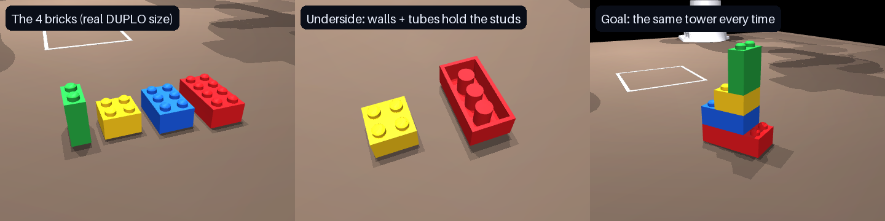
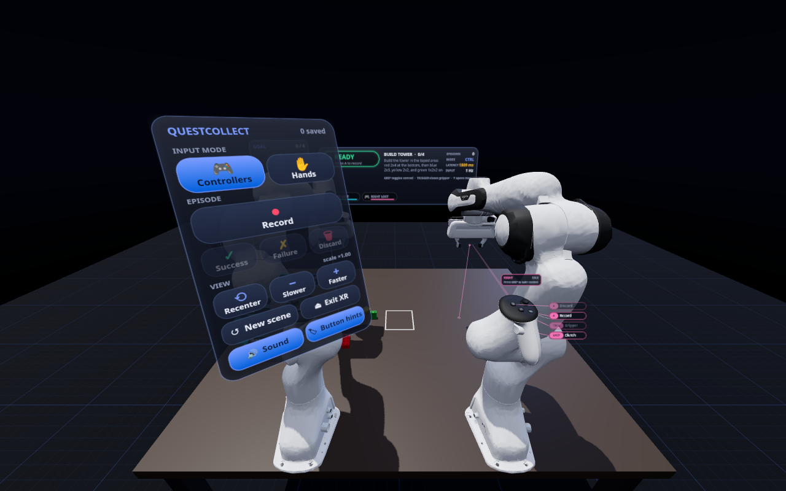
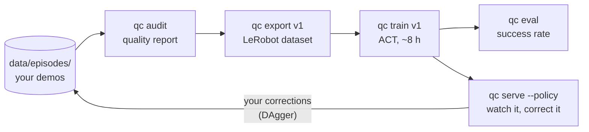
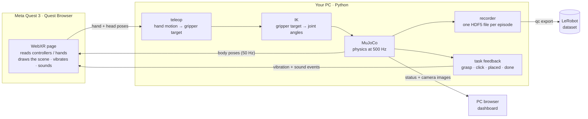

# QuestCollect

**Control two simulated robot arms with a Meta Quest 3, build a DUPLO tower, and record every attempt as training
data for robot learning.**


[](LICENSE)

<p align="center">
  
  <br><sub>Two Franka Panda arms build the tower. This clip is scripted by
  <a href="scripts/make_media.py">scripts/make_media.py</a>, using the same IK, gripper and brick physics as the headset.</sub>
</p>

To teach a robot a task by imitation, you need many examples of a person doing that task *with the robot*.
QuestCollect produces those examples in simulation:

1. Two **Franka Panda** arms stand side by side at a table in the **[MuJoCo](https://mujoco.org)** physics
   simulator on your PC.
2. You put on a **Meta Quest 3** and open a web page. You see the table and the arms in VR (or mixed reality) and
   move them with the **Touch controllers** or your **bare hands**.
3. Every attempt is saved as one **episode** file, with the complete simulator state at every step.
4. A quality check picks the clean demonstrations, one command turns them into a
   **[LeRobot](https://github.com/huggingface/lerobot) dataset**, and another trains a policy (ACT) on it.
5. The trained policy is tested in the simulator, and you can watch it in the headset and take over to correct it.

Nothing is installed on the headset: the PC serves a web page and the Quest Browser opens it.

<table>
  <tr>
    <td width="50%"></td>
    <td width="50%"></td>
  </tr>
  <tr>
    <td align="center"><sub><b>In the headset:</b> goal panel, status panel, and your controllers with a label on every button</sub></td>
    <td align="center"><sub><b>On the PC:</b> live 3D view, the four recorded cameras, the goal, the recorder and the saved episodes</sub></td>
  </tr>
</table>

## Contents

- [Quick start](#quick-start)
- [The task: build the tower](#the-task-build-the-tower)
- [Installation](#installation)
- [Usage](#usage):
  [1. Start the server](#1-start-the-server) ·
  [2. Connect the Quest](#2-connect-the-quest-3) ·
  [3. Controls](#3-controls) ·
  [4. Record](#4-record-demonstrations) ·
  [5. Train a policy](#5-train-and-evaluate-a-policy)
- [What gets recorded](#what-gets-recorded)
- [How it works](#how-it-works)
- [Repository layout](#repository-layout)
- [Configuration](#configuration)
- [Troubleshooting](#troubleshooting)
- [Development](#development)
- [Acknowledgements](#acknowledgements) · [License](#license)

## Quick start

On Linux, with [uv](https://docs.astral.sh/uv/), Node.js ≥ 20 and git installed:

```bash
git clone https://github.com/HarunSMetin/MetaQuest3DataCollection.git
cd MetaQuest3DataCollection
./scripts/fetch_assets.sh                 # download the Franka Panda model
uv sync                                   # create the Python environment
(cd web && npm ci && npm run build)       # build the headset page and the dashboard
uv run qc serve                           # start, then open http://localhost:8000/dashboard/
```

You don't need a headset for a first look: the dashboard shows the live scene and the cameras, and
`uv run qc view` opens the scene in MuJoCo's own viewer. When you're ready, [connect the Quest](#2-connect-the-quest-3).

## The task: build the tower

<p align="center"></p>

There are four **real DUPLO parts**, the same bricks in the same colours in every episode; only where they start
on the table changes. Your job is to stack them into **the same tower every time**, pressing each brick down until
it **clicks**:

| Step | Brick (LEGO part) | Size | Mass | Where it goes |
| --- | --- | --- | --- | --- |
| 1 (base) | 🟥 red 2x4 (3011) | 63.8 × 31.8 × 19.2 mm | 12.2 g | inside the **taped square** on the table, facing any way |
| 2 | 🟦 blue 2x3 (87084) | 47.8 × 31.8 × 19.2 mm | 9.6 g | on the red brick, flush with one end (one row of red studs stays free) |
| 3 | 🟨 yellow 2x2 (3437) | 31.8 × 31.8 × 19.2 mm | 6.75 g | on the blue brick, flush with its *other* end (a zig-zag) |
| 4 | 🟩 green 1x2x2 (4066) | 31.8 × 15.8 × 38.4 mm | 7.95 g | on the yellow brick, turned 90°, on the half that sticks out furthest |

**When does it count as done?** The red brick lies completely inside the taped square, the three bricks above it
are clicked into their correct spots, neither gripper is holding a brick, and the tower is standing still.
Recording then stops on its own one second later.

The **goal panel** (in the headset and on the dashboard) shows the target tower, which brick is next and what is
already done (✓), counting the base once it is in the square: *0 / 4* to *4 / 4*.

### What is simulated, and how closely

| | |
| --- | --- |
| **Brick shapes** | Real DUPLO dimensions: 16 mm between studs, 19.2 mm per brick height, studs 9.4 mm across and 4.5 mm tall. The studs, the walls and the tubes underneath are all collision shapes, so a brick only sits flat on the stud grid. DUPLO has no 1-high 1x2 brick, so the top one is the tall 1x2x2. |
| **Brick masses** | BrickLink's published values. |
| **Seating** | The studs have a bevelled top, so a brick that is up to ~1.5 mm off slides into place as you press it down. |
| **Clicking** | A brick that is only set down is loose. **Press it down** (≈ 6 N) and it clicks: from then on the two bricks move as one. **Pull or peel** (≈ 10 N) to take it off again. Lifting a clicked brick lifts the bricks clicked under it. |
| **Stiffness** | Contacts are stiff: bricks don't sink into each other or spring back when you press on the stack. |
| **Gripper** | Like the real Franka Hand: the fingers move at 50 mm/s and squeeze with a set force (40 N by default; the real hand does up to 70 N), whatever the brick's width. |
| **Collisions** | The arms collide with the table, the bricks and each other. A blocked arm stops; it doesn't push through, and it doesn't jump when it comes free. |
| **The taped square** | 14 × 14 cm in the middle of the table. It is part of the scene, so the recorded cameras see it, like tape on a real table. Bricks never start inside it. |

<details>
<summary><b>How the click works in a rigid-body simulator</b></summary>

MuJoCo's bodies are rigid, so the slightly elastic press fit of real studs can't be simulated directly. Instead,
there is one switched-off *weld* constraint for every pair of bricks. It switches on, holding the two bricks
exactly where they are, when the upper brick sits on the lower one's stud grid and is pressed down harder than
`CLUTCH_PRESS_N`. It switches off when it has to hold the bricks together with more than `CLUTCH_PULL_N` (pulling
or sideways force; pressing harder on a clicked brick never pops it off). Both forces are estimates; measure your
own bricks and set them at the top of [questcollect/sim.py](questcollect/sim.py).
</details>

## Installation

### Requirements

| | Needed for |
| --- | --- |
| **Linux** (developed on Ubuntu) | everything. A GPU with EGL drivers is recommended for the camera images. |
| **[uv](https://docs.astral.sh/uv/)** | the Python environment. It installs Python 3.12 for you. |
| **Node.js ≥ 20** | building the web pages (once, and after changes to `web/`). |
| **git** | downloading the robot model. |
| **Meta Quest 3** | teleoperation. Optional for a first look. |
| **adb** (`sudo apt install android-tools-adb`) | the USB connection to the headset. |
| **openssl** (usually preinstalled) | the Wi-Fi connection only. |
| **NVIDIA GPU** with ≥ 6 GB (CUDA) | training policies (`qc train`). Recording, export and evaluation also run without one, more slowly. |

<details>
<summary>Installing uv and Node.js</summary>

```bash
curl -LsSf https://astral.sh/uv/install.sh | sh                                                    # uv
curl -o- https://raw.githubusercontent.com/nvm-sh/nvm/v0.40.1/install.sh | bash && nvm install 22    # Node.js via nvm
```

</details>

### Steps

```bash
git clone https://github.com/HarunSMetin/MetaQuest3DataCollection.git
cd MetaQuest3DataCollection

./scripts/fetch_assets.sh              # 1. Franka Panda model from MuJoCo Menagerie -> assets/third_party/
uv sync                                # 2. Python environment (.venv/)
(cd web && npm ci && npm run build)    # 3. headset page + dashboard -> web/dist/
uv run qc doctor                       # 4. check that everything is in place
```

`qc doctor` prints a ✓/✗ checklist with a hint next to anything missing. The first four items (robot model,
scene, rendering, web build) are all you need to start; adb, the headset and the certificate only matter for
connecting the Quest.

## Usage

Everything goes through the `qc` command (run it as `uv run qc …`; every command has `--help`):

| Command | What it does |
| --- | --- |
| `qc serve` | start the simulator, the web pages and the recorder |
| `qc setup-quest` | connect a headset plugged in over USB |
| `qc certs` | create a certificate for connecting over Wi-Fi |
| `qc view` | open the scene in MuJoCo's own viewer (no headset) |
| `qc inspect <file>` | show what is inside an episode file |
| `qc replay <file>` | play an episode back in MuJoCo's viewer |
| `qc audit` | quality report of every episode, and which ones training will use |
| `qc export <name>` | turn the selected episodes into a LeRobot dataset |
| `qc train <dataset>` | train a policy on a dataset (lerobot-train) |
| `qc eval <run>` | test a trained policy in the simulator |
| `qc doctor` | check the installation |

### 1. Start the server

```bash
uv run qc serve                     # options: --mode hands · --config my.yaml · --no-https · --policy outputs/<run>
```

Keep this terminal open and open **<http://localhost:8000/dashboard/>** on the PC. You should see both arms, the
bricks, four camera images and the recorder. The terminal prints the addresses for the headset.

### 2. Connect the Quest 3

The Quest Browser only allows VR on `http://localhost` or on `https://` pages, so connect in one of two ways.

#### USB cable (recommended: lowest latency, no certificate)

1. *First time only:* in the Meta Horizon phone app, open your headset's settings and turn on **Developer Mode**.
2. Plug the headset into the PC, put it on and accept **Allow USB debugging**.
3. In a second terminal, run `uv run qc setup-quest`. This makes the headset's `localhost:8000` reach the PC.
4. In the **Quest Browser**, open `http://localhost:8000/xr/` and press **Enter VR** (or **Enter Mixed Reality**).

Run `qc setup-quest` again after you replug the cable or restart the headset.

#### Wi-Fi

```bash
uv run qc certs     # once: a self-signed certificate for this PC's network address (saved in certs/)
uv run qc serve     # restart: it now also serves https on port 8443
```

Open the `https://<pc-ip>:8443/xr/` address the server prints, and accept the certificate warning once
(Advanced → Proceed). Use 5 or 6 GHz Wi-Fi, ideally with the PC on a cable.

**Hand tracking** needs Settings → Movement tracking → **Hand and body tracking** turned on in the headset.

<p align="center"><br>
<sub>The start page in the Quest Browser. Pick controllers or hands, then enter VR.</sub></p>

### 3. Controls

When you enter VR, the table is placed in front of you automatically. Each arm follows one hand: **left hand →
left arm** (cyan), **right hand → right arm** (pink). An arm moves only while you have *taken control* of it, like
a mouse that only moves the cursor while it's on the desk: take control, move, let go, move your hand somewhere
comfortable, take control again, and the arm carries on from where it was.

| Action | Controllers | Hands |
| --- | --- | --- |
| Take / give up control of an arm | press **Grip** (toggles) | pinch **thumb + middle finger** (toggles) |
| Close / open the gripper | **Trigger** (how far you pull = how far it closes) | distance between **thumb and index finger** |
| Start / stop recording | **A** | wrist menu |
| Save the take | **X** | wrist menu |
| Throw the take away | **B** | wrist menu |
| Open the wrist menu | **Y** | turn your **left palm** towards your face |
| Re-place the table in front of you | **left stick click** | wrist menu |

**What you see in the headset:**

- **Your controllers**, with a label next to every button saying what it does right now. A label lights up while
  you press it and dims when the action isn't available (e.g. *Save* before anything was recorded). A tag above
  each controller shows whether it controls its arm, which brick it holds, *Out of reach* and *REC*. The controller
  glows in its arm's colour while it controls the arm.
- **The grasp point**: a small dot between each gripper's fingers, with a line down to the table to help you line
  up a brick. It turns **red** when the arm can't reach where you're pointing; move back towards the robot.
- **The status panel** above the far table edge: recorder state, the task, latency and input rate.
- **The goal panel** to its left: the target tower and your progress.
- **The wrist menu** (below): input mode; record, save as success, save as failure, discard; recenter; motion
  scale (*Slower* / *Faster*); new scene; exit VR; sound on/off; button labels on/off.

<p align="center"></p>

**Vibration and sound.** Every event has its own vibration pattern and sound, so you can tell what happened
without looking. Sounds come from the side of the arm involved.

| What happened | You feel | You hear |
| --- | --- | --- |
| You took / gave up control of an arm | a pulse / a softer pulse | a rising / falling blip |
| Your gripper closed on a brick | one short pulse in that hand | a low *tock* |
| You are holding a brick | a faint tick, 4 times a second | — |
| You let go | a soft blip | a short tick |
| A brick clicked onto studs (not its tower spot) | a short, sharp click | a plastic *snap* |
| A clicked brick was pulled off | a medium blip | a falling pop |
| The base brick was set down inside the taped square | — | a soft chime |
| A brick clicked into its correct spot on the tower | a strong **double** pulse | a two-note chime |
| The tower is finished and standing | a long **triple** pulse in both hands | a rising arpeggio |
| The arms hit each other / an arm touched the table | a short buzz | a low buzz / a thump |
| The arm can't reach where you're pointing | a short buzz | a double beep |

Vibration needs the controllers. Sound starts when you press *Enter VR* and can be muted in the wrist menu.

### 4. Record demonstrations

Each take goes through these stages:

```text
ready ──A──▶ 3 s countdown ──▶ recording ──A (or 1 s after success)──▶ review ──X──▶ saved
                                                                          └──B──▶ discarded
```

After you save or discard, the same four bricks start in new random places. **X** marks the take as a success if
the tower was finished at some point during it; on the dashboard and in the wrist menu you can also save a take
explicitly as a *success* or a *failure*.

**On the dashboard:** `Space` record / stop · `S` save as success · `F` save as failure · `D` discard ·
`R` new scene · `C` recenter. Set the operator name in the Recorder card; it is stored in every episode.

**Tips for good demonstrations:**

- Grab bricks across their narrow side, about halfway up.
- Lower each brick onto the one below slowly. Once it's close, a small wiggle lets the studs centre it.
- Then **push down** until you feel the double pulse: the brick has clicked into its correct spot. Only then let go.
- Build the same way every time (same order, similar grasps), so the dataset is consistent.

Episodes are saved as `data/episodes/episode_000000.hdf5`, `episode_000001.hdf5`, … (about 6 MB per minute).
Check or replay one:

```bash
uv run qc inspect data/episodes/episode_000000.hdf5   # metadata and the shape of every field
uv run qc replay  data/episodes/episode_000000.hdf5   # play it back in MuJoCo's viewer (--speed 2 for faster)
```

The dashboard's **Dataset** card lists all episodes: ▶ replays one in the scene (also shown in the headset), 🗑
deletes it.

### 5. Train and evaluate a policy

From recorded demonstrations to a policy that builds the tower by itself, in five commands. Everything here
needs the learning extra (LeRobot and PyTorch, a few GB):

```bash
uv sync --extra learn
```



**1. Check the data.** `qc audit` replays every episode and reports how often an arm touched the table or the
other arm, how much of it is idle, and when each tower level clicked in. It shows which episodes a dataset will
use and why the others are left out:

```bash
uv run qc audit                                              # report (cached after the first run)
uv run qc audit --exclude episode_000012.hdf5 --note "clumsy"  # leave one out by hand (--include to undo)
```

```text
episode_000001.hdf5     118.5s   2.3%  0.0%   2.0%   7%   39.5  68.2 103.7   ✗ arm link on the table 2.3% of the time (limit 1.0%)
episode_000006.hdf5      44.9s   0.0%  0.0%  45.0%   4%   19.2  21.3  43.8   ✗ hand dragging on the table 45.0% of the time (limit 30.0%)
episode_000086.hdf5      51.5s   0.0%  0.0%   1.5%   7%   18.9  38.0  49.4   ✓ 51 s used

78 of 87 episodes used: 83.8 of 94.8 min (78 segments).
```

The rules (contact limits, trimming the still start and end of each take, failed takes) are the `curate`
section of [config.yaml](config.yaml). The dashboard's Dataset card shows the same verdict per episode (⚠ / ✓)
and can exclude an episode (⊘). Your episode files are never changed.

**2. Export a dataset.** Renders the cameras from the recorded states, in the scene each episode was recorded in:

```bash
uv run qc export v1                       # -> data/lerobot/v1  (~35 s per minute of demonstrations)
uv run qc export v1b --randomize-visuals  # vary lights, colours and camera mounts (more robust to looks)
```

What the policy sees and outputs is the `learn` section of the config: by default `cam_high` and both wrist
cameras at 240×320, plus joint angles and gripper openings, and joint targets as actions (the ACT recipe). Each
dataset stores these settings in its `questcollect_manifest.json`, together with exactly which episodes and
steps went in.

**3. Train.** Runs [`lerobot-train`](https://github.com/huggingface/lerobot) with a named preset from the config:

```bash
uv run qc train v1                        # preset act_240 -> outputs/<date>_act_240_v1/
uv run qc train v1 --dry-run              # only print the lerobot-train command
uv run qc train v1 --steps=200000         # any extra --key=value goes to lerobot-train
```

The `act_240` preset is [ACT](https://tonyzhaozh.github.io/aloha/) (action chunks of 100 steps = 2 s) sized for a
6 GB laptop GPU (RTX 4050): batch 16, mixed precision, ~3.6 GB of GPU memory, ~8 hours for 100k steps.

**4. Evaluate.** Runs the policy in the simulator on 50 fixed scenes it never saw, as fast as the PC allows:

```bash
uv run qc eval outputs/<run>                  # last checkpoint, 50 rollouts
uv run qc eval outputs/<run> --ensemble 0.01  # ACT temporal ensembling (smoother, slower)
```

It prints the success rate and how far the tower got (base in the square, levels 1–3), the contacts, and how
much the safety filter had to correct. Every rollout is saved as a normal episode file (`qc replay` it to watch a
failure); the numbers go to `outputs/<run>/eval/<time>/metrics.json`.

**5. Watch it, and correct it (DAgger).** Let the policy drive in the headset:

```bash
uv run qc serve --policy outputs/<run>            # shared control: the policy drives, you can take over
uv run qc serve --policy outputs/<run> --control policy   # policy only
```

In shared mode, press **Grip** whenever the policy is about to go wrong. You take over that arm from exactly where
it is; release it and the policy carries on. Record while you do this: the steps you drove are marked in the
episode, and the next `qc export` uses only your corrections from these takes (`curate.dagger_frames`). That is
the most effective data you can add: it shows the policy how to recover from its own mistakes. The dashboard's
Teleoperation card switches between *You drive*, *Shared* and *Policy*.

**Collisions.** Three layers keep the arms off the table and away from each other:

| Layer | What it does |
| --- | --- |
| Clean data | `qc audit` leaves out takes where an arm rested on the table, the arms touched, or the hand dragged along the table. |
| Recovery data | DAgger corrections (above), and optionally `record.action_noise` (DART): small noise on what is executed while you record, so the data shows how you recover. |
| Safety filter | Every policy action passes [questcollect/safety.py](questcollect/safety.py): it changes the joint targets as little as possible so the arms stay ≥ 2 cm apart and 1 cm above the table (fingertips may touch it). |

## What gets recorded

One HDF5 file per episode, one row per control step (**50 per second**). The authoritative field list is the
docstring at the top of [questcollect/recorder.py](questcollect/recorder.py).

| Field | Shape | Contents |
| --- | --- | --- |
| `obs/joint_pos`, `obs/joint_vel` | (T, 14) | joint angles and velocities, `[left 7, right 7]` |
| `obs/gripper_width` | (T, 2) | finger opening in metres (0 to 0.08) |
| `obs/ee_pose_left`, `obs/ee_pose_right` | (T, 7) | gripper pose: position + quaternion (w x y z), world frame |
| `obs/objects` | (T, 4, 7) | the four brick poses (bottom centre of each brick) |
| `action/joint_pos` | (T, 16) | **[7 left joints, left gripper, 7 right joints, right gripper]**, the ALOHA/ACT layout; gripper 0 = closed, 1 = open |
| `action/ee_pose` | (T, 16) | where the grippers were sent: left pose, right pose, two gripper values |
| `sim/state` | (T, 407) | the complete simulator state before each step, including which bricks are clicked together |
| `success` | (T,) | whether the tower is finished and standing |
| `progress` | (T,) | bricks correctly clicked onto the base so far (0–3); useful as sub-task labels |
| `clutch` | (T, 6) | which of the 6 brick pairs are clicked together |
| `contacts` | (T, 3) | an arm link on the table, the two arms touching, a hand or fingertip on the table |
| `control/source` | (T,) | who drove this step: 0 you, 1 a policy (shared-control takes) |
| `teleop/*` | | head pose; per hand the raw controller pose and buttons or 25 hand-joint poses, pinch distances; engaged / tracked flags; latency |
| `time`, `wall_time` | (T,) | simulation time and PC clock |
| *file attributes* | | task, instruction, operator, input mode, source (teleop / policy / shared), success, random seed, date, duration, the full scene (MJCF) and its fingerprint, the config, camera names, and the tower definition |

<details>
<summary>Example: <code>qc inspect</code> on a 51-second episode</summary>

```text
    camera_names: ['cam_high', 'cam_low', 'cam_left_wrist', 'cam_right_wrist']
      duration_s: 51.54
             fps: 50
      input_mode: controllers
     instruction: Build the tower in the taped area: red 2x4 at the bottom, then blue 2x3, yellow 2x2, and
                  green 1x2x2 on top. Press each brick down until it clicks.
       num_steps: 2577
         objects: ['red_2x4', 'blue_2x3', 'yellow_2x2', 'green_1x2x2']
  schema_version: 4   (files recorded now are version 5: + contacts, control/source)
         success: True
            task: build_tower
             ...

action/ee_pose                   (2577, 16)         float64
action/joint_pos                 (2577, 16)         float64
clutch                           (2577, 6)          bool
obs/ee_pose_left                 (2577, 7)          float64
obs/joint_pos                    (2577, 14)         float64
obs/objects                      (2577, 4, 7)       float64
progress                         (2577,)            int64
sim/state                        (2577, 407)        float64
success                          (2577,)            bool
teleop/left/joints               (2577, 25, 7)      float64
...
```

</details>

**Camera images are not stored while recording.** Because the complete simulator state is saved, the exporter
replays every step exactly and renders the cameras afterwards, at whatever resolution you choose, in the scene
the episode was recorded in (each file stores its config and a fingerprint of the scene). Recording stays
light, and you can re-export with other image sizes without recording again. The four cameras use the ALOHA
names, so existing ACT configs work as they are:

<p align="center"></p>

**The LeRobot dataset** contains:

| Feature | Shape | Contents |
| --- | --- | --- |
| `observation.state` | (16,) | joint angles + gripper openings (or gripper poses with `learn.action: ee`) |
| `action` | (16,) | `action/joint_pos` (or `action/ee_pose`) |
| `observation.images.<camera>` | (H, W, 3) | one video per camera in `learn.cameras`, re-rendered from `sim/state` |
| `observation.environment_state` | (28,) | the four brick poses, only with `learn.env_state: true` (simulation only; a real robot doesn't have these) |
| `task` | text | the instruction, used as the language prompt |

## How it works



- **The simulation runs only on the PC**, in one 50 Hz loop: read the latest hand poses, turn them into gripper
  targets, solve inverse kinematics for both arms, step the physics, record. The headset only sends what it
  tracks and draws what the PC sends back, so the robot you see is exactly the robot that gets recorded.
- **Hand motion is relative.** While you control an arm, its gripper moves by as much as your hand has moved
  (times the motion scale) since you took control. Your hand motion is smoothed, and a tracking glitch (a jump of
  more than 12 cm, or no data for 0.25 s) releases the arm until you take control again. Targets outside the
  reachable workspace box are clamped.
- **Everything the browser shows comes from the server.** The headset and the dashboard rebuild the 3D scene
  from geometry the server exports, and draw the goal from the task description it publishes, so changing the
  scene or the tower in Python needs no changes in the browser code.

The full picture (threads, the 50 Hz tick step by step, the wire protocol, coordinate frames, the IK, the brick
physics, and which files change together) is in **[docs/architecture.md](docs/architecture.md)**.

## Repository layout

```text
questcollect/              the Python package, one module per stage of the pipeline
  cli.py                   the `qc` command (serve, setup-quest, certs, view, inspect, replay, audit, export,
                           train, eval, doctor)
  config.py                loads config.yaml into typed settings
  sim.py                   the MuJoCo scene, the bricks, the tower task (progress, success), the environment
  frames.py                converts poses between the headset's coordinates and the simulator's
  teleop.py                hand / controller motion → gripper targets (clutch, smoothing, safety checks)
  ik.py                    gripper targets → joint angles for both arms (inverse kinematics with mink)
  runtime.py               the 50 Hz loop: input → teleop → IK (or policy → safety filter) → physics → record,
                           plus vibration and sound events
  recorder.py              record / save / discard logic and the HDF5 episode format
  server.py                web server: the pages, the REST API, websockets to the headset and the dashboard
  protocol.py              binary message format between headset and server (mirrored in web/src/protocol.ts)
  scene_export.py          sends the scene's shapes and meshes to the browser so it can draw them
  audit.py                 episode quality report (contacts, idle time) and which steps training uses
  safety.py                safety filter on policy actions: arms apart, off the table
  learn/                   policy learning; the only code that uses PyTorch / LeRobot (`uv sync --extra learn`)
    features.py            what a policy sees and outputs (shared by export and the policy runner)
    export.py              selected episodes → LeRobot dataset (re-renders the cameras) + manifest
    train.py               presets → lerobot-train runs in outputs/<run>/
    policy.py              runs a trained policy on the simulated arms
    evaluate.py            `qc eval`: rollouts on held-out scenes, success and stage metrics
web/                       the browser side (TypeScript, three.js, React), built into web/dist/
  xr/index.html            the headset page    → code in src/xr/        (WebXR app, panels, controllers, sounds)
  dashboard/index.html     the PC dashboard    → code in src/dashboard/ (React)
  src/MujocoScene.ts       draws the MuJoCo scene with three.js (used by both pages)
  src/goal.ts              draws the goal tower (used by both pages)
  src/protocol.ts, net.ts  message formats and the websocket connection
  public/xr-profiles/      Quest 3 Touch Plus controller models (vendored, MIT)
  e2e/                     tests with an emulated Quest 3, and the README screenshots
tests/                     Python tests: teleop, protocol; physics, clicking, gripper, IK, recording; audit,
                           safety filter, shared control; export → train → eval (test_learn.py)
scripts/
  fetch_assets.sh          downloads the Franka model from MuJoCo Menagerie into assets/third_party/
  make_media.py            renders docs/media/demo.gif, tower.png, cameras.png
docs/
  architecture.md          how the code works, for developers
  media/                   the images and the GIF in this README
config.yaml                all settings
```

Created when you run things (all gitignored): `.venv/`, `assets/third_party/` (robot model), `web/node_modules/`,
`web/dist/`, `certs/` (Wi-Fi certificate), `data/episodes/` (your recordings, plus `audit.json` and
`curation.json` next to them), `data/lerobot/<name>/` (datasets), `outputs/<run>/` (training runs and evaluations).

## Configuration

Runtime settings live in [config.yaml](config.yaml). Use another file with `uv run qc serve --config my.yaml`.

| Setting | Default | Meaning |
| --- | --- | --- |
| `sim.physics_dt` | 0.002 | physics step (500 Hz) |
| `sim.control_hz` | 50 | control and recording rate |
| `sim.table_height`, `sim.arm_spacing` | 0.75, 0.6 | table height and distance between the arm bases (m) |
| `sim.gripper_force` | 40 | squeeze force on a grasped object (N; the real Franka Hand does up to 70) |
| `teleop.mode` | `controllers` | `controllers` or `hands` (also switchable in the headset and on the dashboard) |
| `teleop.scale` | 1.0 | hand motion → gripper motion (the wrist menu's *Slower* / *Faster*) |
| `teleop.pinch_open_m`, `pinch_closed_m` | 0.08, 0.015 | thumb–index distances for a fully open / closed gripper in hand mode (m) |
| `teleop.filter_min_cutoff`, `filter_beta` | 1.5, 0.5 | smoothing (One-Euro filter): lower cutoff = smoother, higher beta = less lag in fast moves |
| `teleop.workspace_min`, `workspace_max` | | the box the grippers are kept in (world frame, m) |
| `ik.position_cost`, `orientation_cost`, `posture_cost` | 1.0, 0.6, 0.01 | IK weights |
| `ik.max_joint_vel` | 2.5 | joint speed limit (rad/s) |
| `ik.max_lead` | 0.15 | how far (rad) the IK may run ahead of a blocked arm |
| `ik.avoid_arm_collisions`, `collision_margin` | false, 0.03 | let the IK steer the arms around each other instead of letting them collide |
| `ik.iterations` | 2 | IK solver iterations per control step |
| `record.out_dir` | `data/episodes` | where episodes are saved |
| `record.countdown_s` | 3 | countdown before recording starts (s) |
| `record.cameras` | the four cameras | camera previews on the dashboard |
| `record.operator` | `operator` | default operator name stored in episodes |
| `record.action_noise` | 0 | DART: rad of noise on the executed joint targets while recording (the clean target is recorded) |
| `server.host`, `port`, `https_port`, `cert_dir` | 0.0.0.0, 8000, 8443, `certs` | network address, ports and certificate folder |
| `curate.*` | | which episodes and steps training uses: contact limits, `trim_idle`, `include_failures`, `dagger_frames` |
| `learn.cameras`, `image_size`, `action`, `env_state` | 3 cameras, 240×320, joint, false | what a policy sees and outputs |
| `learn.datasets_dir`, `runs_dir` | `data/lerobot`, `outputs` | where datasets and training runs go |
| `learn.presets` | `act_240` | named lerobot-train settings for `qc train --preset` |
| `safety.enabled`, `arm_margin`, `table_margin` | true, 0.02, 0.01 | the safety filter on policy actions (m) |
| `control.mode`, `policy`, `n_action_steps` | teleop, none, 10 | who drives in `qc serve`, and how often a live policy is asked |

**The task** is defined by constants at the top of [questcollect/sim.py](questcollect/sim.py): the bricks
(`BRICKS`: size, colour, mass), the tower layout (`TOWER`), the taped square (`BUILD_AREA_CENTER`,
`BUILD_AREA_HALF`), placement tolerances (`TOL_*`), stud clearance (`PLAY`) and the click forces
(`CLUTCH_PRESS_N`, `CLUTCH_PULL_N`). The goal panels follow these automatically. The vibration patterns are the
`HAPTIC_*` constants in [questcollect/runtime.py](questcollect/runtime.py); the sounds are in
[web/src/xr/sounds.ts](web/src/xr/sounds.ts).

## Troubleshooting

| Problem | Fix |
| --- | --- |
| **Enter VR** is greyed out | You are not in the Quest Browser, or the address is not `http://localhost` / `https://`. Run `qc setup-quest` again after replugging. |
| `qc setup-quest` says *no device* or *unauthorized* | Turn on Developer Mode, put the headset on and accept the USB debugging prompt. |
| No camera images, or `qc doctor` fails at rendering | Check the NVIDIA EGL drivers, or try `MUJOCO_GL=osmesa uv run qc serve`. |
| The page says *Web client not built* | `cd web && npm ci && npm run build` |
| The arm doesn't move | Take control with **Grip** (after a tracking glitch the arm is released). Look for *Pick up controllers* / *Put controllers down* (the input mode doesn't match what you're holding) or *Out of reach*. |
| The grasp-point dot is red | The arm can't get there: too far from its base (more than ~0.8 m), right in front of its own base, or the wrist is twisted to its limit. Move back towards the robot or turn your wrist back. |
| No vibration | Vibration needs the controllers; with hand tracking there is nothing to vibrate. |
| No sound | Sound starts when you press **Enter VR** (browsers block audio before a click). Check **Sound** in the wrist menu and the headset volume. |
| The tower is built but doesn't count | The red brick must lie completely inside the taped square, every brick must be clicked, and you must let go of the last brick. The goal panel shows which step is missing. |
| A brick won't click | It must sit flat on the stud grid; then push down harder. Lower `CLUTCH_PRESS_N` in `questcollect/sim.py` if needed. |
| Bricks are hard to seat | Raise `PLAY` (stud clearance) in `questcollect/sim.py`. |
| A brick slips in the gripper | Raise `sim.gripper_force` in `config.yaml`. |
| Laggy over Wi-Fi | Use the USB cable, or move closer to a 5/6 GHz access point. |
| `qc export` says the dataset already exists | Datasets are never overwritten: pick a new name, or delete `data/lerobot/<name>`. |
| `qc eval` / `serve --policy`: *not inside a qc train run* | Point it at the run folder `outputs/<run>` made by `qc train` (it holds the dataset settings the policy needs). |
| `EGLError` printed when a command exits | Harmless: MuJoCo's GL context is cleaned up after Python has shut down. |

## Development

```bash
uv run --group dev pytest                               # Python tests (~10 s)
MUJOCO_GL=egl uv run --extra learn --group dev pytest   # + export -> train -> eval end to end (~20 s)
cd web && npm run typecheck                  # TypeScript
cd web && npm run dev                        # pages with hot reload on :5173 (proxies to a running `qc serve`)
```

**Testing without a headset.** Open `/xr/` in desktop Chrome with Meta's
[Immersive Web Emulator](https://chromewebstore.google.com/detail/immersive-web-emulator/cgffilbpcibhmcfbgggfhfolhkfbhmik)
extension, or run the automated test [web/e2e/emulated-quest.mjs](web/e2e/emulated-quest.mjs): it drives an
emulated Quest 3 in a headless browser against a running server and checks controllers, hand tracking, the clutch,
the gripper and the record → save flow. Setup is at the top of the file. Point that server at a scratch
`record.out_dir`, because the test saves a few episodes.

**Regenerating the README media:**

```bash
MUJOCO_GL=egl uv run python scripts/make_media.py   # demo.gif, tower.png, cameras.png (must print success: True)
cd web/e2e && npm run screenshots                   # dashboard.png, xr_landing.png, xr_headset.png, xr_menu.png
                                                    # (needs `uv run qc serve --no-https` running)
```

Before changing the code, read [docs/architecture.md](docs/architecture.md): it explains the threads, the wire
protocol, and which files have to change together.

## Acknowledgements

- Franka Emika Panda model from [MuJoCo Menagerie](https://github.com/google-deepmind/mujoco_menagerie)
  (Apache-2.0), downloaded by `scripts/fetch_assets.sh`; not included in this repository.
- Quest 3 Touch Plus controller models from [WebXR Input Profiles](https://github.com/immersive-web/webxr-input-profiles)
  (MIT), in `web/public/xr-profiles/`.
- [MuJoCo](https://mujoco.org) for physics, [mink](https://github.com/kevinzakka/mink) for inverse kinematics,
  [three.js](https://threejs.org/) for rendering, [LeRobot](https://github.com/huggingface/lerobot) for the dataset
  format, and Meta's [IWER](https://github.com/meta-quest/immersive-web-emulation-runtime) for headset-free testing.
- Camera names and action layout follow [ALOHA](https://tonyzhaozh.github.io/aloha/) / ACT.
- Brick masses from [BrickLink](https://www.bricklink.com/) (parts 3011, 87084, 3437, 4066); Franka Hand speed
  and force from its published specifications.
- LEGO® and DUPLO® are trademarks of the LEGO Group, which does not sponsor or endorse this project. The bricks
  here are simplified models built to DUPLO's published dimensions.

## License

QuestCollect is released under the [MIT License](LICENSE). Third-party parts keep their own licenses: the Franka
Panda model (Apache-2.0, downloaded separately) and the controller models in `web/public/xr-profiles/` (MIT).
