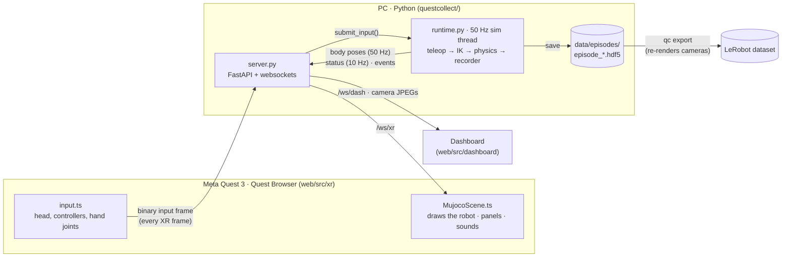

# How QuestCollect works

This is the developer guide: what each part of the code does, how data moves through it, and where to change
things. For installing and using QuestCollect, see the [README](../README.md).

- [The big picture](#the-big-picture)
- [One control tick](#one-control-tick)
- [Threads and who owns what](#threads-and-who-owns-what)
- [Network: endpoints and the wire protocol](#network-endpoints-and-the-wire-protocol)
- [Coordinate frames](#coordinate-frames)
- [Teleoperation: from hand to arm target](#teleoperation-from-hand-to-arm-target)
- [Inverse kinematics](#inverse-kinematics)
- [The scene and the task](#the-scene-and-the-task)
- [Recording, replay and export](#recording-replay-and-export)
- [Policy learning](#policy-learning)
- [The web client](#the-web-client)
- [Common changes](#common-changes)
- [Tests](#tests)

## The big picture



The simulation exists only on the PC. The headset sends what it tracks (head, controllers or hands) and draws
the body poses the PC sends back, so the robot the operator sees is the same robot that is recorded. The
headset and the dashboard both rebuild the 3D scene from geometry the server exports (`/api/scene`), so nothing
about the robot or the bricks is hard-coded in the browser.

## One control tick

`Runtime._tick` runs 50 times a second (`sim.control_hz`). Each tick, in order:

| Step | Code | What happens |
| --- | --- | --- |
| 1 | `Runtime._process_commands` | Apply queued commands (record, save, reset, set mode, …) from the dashboard, the headset menu or the buttons. |
| 2 | `Teleop.update` | Latest input frame → one end-effector target and one gripper value per arm (see [Teleoperation](#teleoperation-from-hand-to-arm-target)). |
| 3 | `BimanualIK.follow` + `solve` | Targets → 14 joint angles, with the IK held within `ik.max_lead` of the measured joints. When a policy drives instead (see [Control modes](#policy-learning)): `PolicyRunner.act` → `SafetyFilter.filter`. |
| 4 | `Recorder.tick` | Advance the countdown; switch to recording when it ends. |
| 5 | `BimanualEnv.observe` / `get_state` | If recording: snapshot the observation and the full sim state *before* the step. |
| 6 | `BimanualEnv.apply_action` | Joint targets (plus DART noise if `record.action_noise`) to the arm servos; the gripper target moves at 50 mm/s per finger. |
| 7 | `Recorder.append` | If recording: store the step built by `recorder.make_step` (obs, action, state, success, progress, clutch, contacts, who drove, raw teleop). |
| 8 | `BimanualEnv.step` | 10 physics substeps (`physics_dt` = 2 ms), then `_update_clutch` clicks or unclicks bricks. |
| 9 | `Runtime._task_feedback` | Compare grasp / progress / clutch state with the last tick and emit haptic, sound and toast events. |
| 10 | `Runtime._check_warnings` | Arm–arm and arm–table contacts (`BimanualEnv.contact_flags`, the one contact definition also used by recording, audit and evaluation), out-of-reach targets. |
| 11 | `Runtime._publish` | Pack the pose frame; every 5th tick the status dict; every 6th tick camera previews (only while someone is looking). |

During a replay (`replay` command or `qc replay`), steps 2–10 are skipped: the tick just loads the next recorded
state with `BimanualEnv.set_state`.

## Threads and who owns what

| Thread | Owns | Talks to the others through |
| --- | --- | --- |
| **sim** (`Runtime._run`) | the MuJoCo model and data, IK, teleop, recorder | — |
| **asyncio** (uvicorn, `server.py`) | websockets, HTTP | `Runtime.submit_input`, `command`, `latest_pose_frame`, `status`, `previews` (all lock-protected), and events pushed through `Runtime.add_listener` → `Hub` |
| **hdf5-writer** (`Recorder`) | writing one finished episode | a single-worker `ThreadPoolExecutor`, so saving never stalls the 50 Hz loop |

Rule: the server never touches simulation state directly. Anything that changes the sim goes through
`Runtime.command(name, **args)`, which queues it for step 1 of the next tick.

## Network: endpoints and the wire protocol

| Endpoint | Direction | Content |
| --- | --- | --- |
| `GET /xr/`, `/dashboard/` | → browser | the built web pages (`web/dist`) |
| `GET /api/scene`, `/api/scene.bin` | → browser | visual geometry: bodies, geoms, materials (JSON) + mesh vertices/faces (binary) |
| `GET /api/task` | → browser | the goal as data: bricks, where each goes, the build area (`sim.task_spec()`) |
| `GET /api/status` | → browser | the latest status dict (same as on the websockets) |
| `GET /api/episodes`, `DELETE /api/episodes?path=` | ↔ | list / delete saved episodes |
| `GET /api/audit`, `POST /api/curation` | ↔ | per-episode audit verdicts; exclude / include an episode for training |
| `POST /api/command` | → server | `{"name": ..., "args": {...}}`, queued to the sim thread |
| `GET /api/preview/<cam>.jpg` | → browser | latest camera preview (rendered only while requested) |
| `WS /ws/xr` | both | headset: binary input frames in; binary pose frames (every tick), JSON status + events out |
| `WS /ws/dash` | both | dashboard: pose frames at 30 Hz, JSON status + events out; JSON commands in |

**Binary frames** are defined in [questcollect/protocol.py](../questcollect/protocol.py) and mirrored by hand
in [web/src/protocol.ts](../web/src/protocol.ts) (little endian, 16-byte headers):

- *Input* (headset → server, every XR frame): header with both hands' input source (none / controller / hand),
  sequence number and an echoed server timestamp (for the round-trip time), then the head pose and, per hand, the
  control pose, 8 button values, 25 hand-joint poses and 2 pinch distances: always 391 floats (1,580 bytes).
- *Pose* (server → clients): header with flags (left engaged, right engaged, recording), body count and server
  time, then every MuJoCo body's world pose.

**JSON events** (server → clients): `status` (10 Hz), `toast`, `haptic` (`arm`, `intensity`, `ms`, `repeat`,
`gap_ms`), `sound` (`name`, `arm`), `saved`.

## Coordinate frames

[questcollect/frames.py](../questcollect/frames.py) converts between the two worlds:

| | Up | Forward | Quaternion order |
| --- | --- | --- | --- |
| WebXR `local-floor` | +y | −z | x y z w |
| MuJoCo world | +z | +x (away from the operator) | w x y z |

`Placement` is the rigid transform that puts the simulated table in the room. The same transform is used to draw
the scene in the headset and to map hand poses back into the world, so what you see is what you control.
*Recenter* (left stick click, wrist menu, or automatically 1.2 s after entering VR) places the operator's head
behind the arm bases, looking along +x, and keeps the simulated floor on the real floor.

## Teleoperation: from hand to arm target

[questcollect/teleop.py](../questcollect/teleop.py), per arm and tick:

```text
XR pose → world (Placement) → jump rejection → One-Euro filter → clutch → workspace clamp → IK target
```

- **Input source.** In *controllers* mode the control pose is the controller's grip pose; in *hands* mode it is
  the middle-finger metacarpal position with the wrist orientation (stable while pinching). If the headset sends
  the other kind of input, `mode_mismatch` is set and the UI says *Pick up controllers* / *Put controllers down*.
- **Clutch** (`ArmClutch`). Toggled by a Grip press (controllers) or a thumb–middle pinch (hands). While engaged,
  target = arm pose at engage time + scaled hand motion since then (`teleop.scale`), and hand rotation is applied
  in the world frame. Releasing and re-engaging never makes the arm jump.
- **Gripper.** Trigger value, or the thumb–index distance mapped between `pinch_closed_m` and `pinch_open_m`.
- **Safety.** Input older than 0.25 s or a jump of more than 12 cm between ticks drops the clutch (the arm holds
  its last target until you engage again). Targets are clamped to `workspace_min/max`.
- **Buttons.** `CONTROLLER_COMMANDS` maps A/B/X/left-stick presses to recorder commands. The headset's button
  labels (`HINTS` in `web/src/xr/visuals.ts`) mirror this table; keep them in sync.

## Inverse kinematics

[questcollect/ik.py](../questcollect/ik.py) uses [mink](https://github.com/kevinzakka/mink) with one QP for
both arms: a frame task per gripper (position + orientation cost), a small posture task, joint position and
velocity limits, and optionally an arm–arm collision limit (`ik.avoid_arm_collisions`, off by default: the
physics handles collisions, like on real arms).

The IK keeps its own model (the same scene without the bricks) and is open-loop, except that `follow()` keeps it
within `ik.max_lead` radians of the measured joints. Without that, an arm blocked by the table or the other arm
would let the IK run on through the obstacle and then yank the arm when it came free. If the target stays more
than 3 cm away from what the IK can reach, the arm is flagged *out of reach*.

## The scene and the task

[questcollect/sim.py](../questcollect/sim.py) builds everything in code with `MjSpec`:

- **Robots.** Two Franka Panda arms from MuJoCo Menagerie, side by side on the near table edge, 0.6 m apart
  (`sim.arm_spacing`), gravity-compensated like the real controller. Each hand has a `tcp` site (the point the
  arm is steered by), a wrist camera and an operator-only grasp-point marker.
- **Gripper.** A stiff servo on the finger tendon whose force is capped at `sim.gripper_force` (40 N), with the
  target moving at the real Franka Hand's 50 mm/s. The four small fingertip pads from Menagerie are merged into
  one flat pad so a brick can't wedge between them.
- **Bricks.** Hollow DUPLO bricks built from boxes and cylinders: top plate, walls, chamfered studs and the tubes
  underneath, at real dimensions and BrickLink masses. Each brick also has an invisible solid `<brick>_core` in its
  hollow underside that only the robot collides with, so a finger can't hook into a brick.
- **Contacts.** Stiff contact parameters (`RIGID_SOLREF`, `RIGID_SOLIMP`), elliptic friction cones and
  `impratio` 10, so bricks don't sink into each other and grasps don't creep.
- **Clicking (clutch).** One inactive weld per brick pair (`CLUTCH_PAIRS`). After every step, `_update_clutch`
  turns a weld on when two bricks touch, `stud_seated` finds the upper one on the lower one's stud grid, and the
  vertical contact force exceeds `CLUTCH_PRESS_N`. It turns it off when the weld has to hold more than
  `CLUTCH_PULL_N` of tension plus shear (compression doesn't count, so pressing harder never pops a brick). The
  weld is softer than the contacts, so the studs carry the press load.
- **Progress and success.** `tower_progress` counts levels that are in the right place (within `TOL_XY`,
  `TOL_Z`, `TOL_YAW`) *and* clicked, bottom-up, and is 0 unless the base lies completely inside the build area.
  `_task_success` = all levels placed, nothing held, and every brick slower than 2 cm/s.
- **Cameras.** `cam_high`, `cam_low`, `cam_left_wrist`, `cam_right_wrist` (ALOHA names). Geom group 5
  (`OPERATOR_GROUP`) holds visuals only the operator sees (grasp-point markers); MuJoCo cameras render groups 0–2,
  so these never reach the recorded images.

## Recording, replay and export

- **State machine** ([questcollect/recorder.py](../questcollect/recorder.py)):
  `idle → countdown (3 s) → recording → review → saved | discarded → idle`. With auto-stop on, recording ends
  1 s after the task first succeeds. Saving resets the scene with a new random brick layout.
- **File format.** One HDF5 file per episode; the full field list is the module docstring of `recorder.py`.
  Every step is built by `recorder.make_step` and every file's attributes by `recorder.episode_meta`, whoever
  drove (the live recorder, `qc eval` rollouts), so all episodes look the same. Images are never recorded.
- **Exact replay.** `sim/state` is MuJoCo's full integration state *plus* the six clutch welds' relative poses.
  The welds live in `model.eq_data`, which `mj_getState` doesn't cover, so always use
  `BimanualEnv.get_state` / `set_state`, never raw `mj_getState`.
- **Replaying in the right scene.** Each episode stores its config and `scene_hash` (a fingerprint of geoms,
  masses, materials, cameras and state layout, computed from the saved MJCF). `sim.env_from_episode(meta)` builds
  the scene from the episode's own config and warns if the fingerprint differs from today's scene.
  `sim.load_recorded_model` compiles a saved `model_xml` (its meshes are found in the Menagerie folder).

## Policy learning

The learning side is a pipeline of stages; each one writes a folder with a manifest, and raw episodes are never
modified:

```text
data/episodes/*.hdf5 ──qc audit──▶ audit.json (+ curation.json) ──qc export──▶ data/lerobot/<name>/
      ▲                                                                              │
      │                                                                         qc train
      │                                                                              ▼
      └──── qc serve --policy (shared control: your corrections) ◀──── outputs/<run>/train/checkpoints/…
                                                                        └── qc eval ──▶ outputs/<run>/eval/<time>/
```

**The dependency rule:** nothing outside [questcollect/learn/](../questcollect/learn/) imports torch or lerobot
(optional extra `learn`), so recording works without them. The runtime imports `learn.policy` only inside
`Runtime.load_policy`.

| Stage | Code | What it does |
| --- | --- | --- |
| audit | [audit.py](../questcollect/audit.py) | `audit_episode`: contact shares and events (from the recorded `contacts`, or by replaying `sim/state` for episodes older than schema v5), idle share, active range, level times, operator-driven runs. `audit_dir` caches by file size + mtime. `select` applies the `curate` rules and `curation.json` and returns `Segment`s plus a reason for every rejected episode. |
| features | [learn/features.py](../questcollect/learn/features.py) | `FeatureSpec`: cameras, image size, joint/ee action, env state. The single definition of observation and action layout, used by export *and* the policy runner; stored in each dataset manifest, so a policy is always fed what it was trained on. |
| export | [learn/export.py](../questcollect/learn/export.py) | per segment: `env_from_episode`, `set_state` each step, render `spec.cameras`, `LeRobotDataset.add_frame`. Optional `AppearanceRandomizer`. Refuses an existing folder; writes `questcollect_manifest.json`. All LeRobot dataset API calls are here. |
| train | [learn/train.py](../questcollect/learn/train.py) | turns a preset from `learn.presets` into a `lerobot-train` command (output in `outputs/<run>/train/`) and writes `questcollect_run.json` (preset, dataset manifest, git commit, the command). |
| policy | [learn/policy.py](../questcollect/learn/policy.py) | `PolicyRunner`: loads a checkpoint with its LeRobot pre/post-processors, renders the cameras at the dataset's size, returns joint targets (end-effector policies go through `BimanualIK`). Skips rendering while ACT still has queued actions. |
| evaluate | [learn/evaluate.py](../questcollect/learn/evaluate.py) | rollouts on fixed seeds (`eval_seeds`, a separate stream from recording seeds), no wall clock; every action through the safety filter; metrics per rollout and summarized; rollouts saved with `make_step`, so `qc replay` and `qc audit` work on them. |

**Safety filter** ([safety.py](../questcollect/safety.py)). One mink QP per control step (8 substeps, because the
collision limits are linearized) on the robot-only scene: a posture task pulls towards the proposed joint targets,
and limits keep joint ranges and speeds, the arms ≥ `safety.arm_margin` apart, the links ≥ `safety.table_margin`
above the table, and the fingertips from pressing into it. In free motion the output equals the input. Its own
configuration stays within `ik.max_lead` of the measured joints, like `BimanualIK.follow`.

**Control modes** (`Runtime._who_drives`). `teleop`: the operator, as always. `policy`: `PolicyRunner.act` →
`SafetyFilter.filter` every tick, buttons still work. `shared` (DAgger): the policy drives until an arm is engaged
(Grip); while the policy drives, `Teleop.sync_hold` and `BimanualIK.reset` keep the operator side at the arms'
current pose, so a takeover never jumps; when every arm is released the policy restarts with a fresh chunk. Each
recorded step stores `control/source`, and `curate.dagger_frames: operator` exports only the operator's steps.
`record.action_noise` (DART) perturbs the *executed* operator targets while recording; the clean ones are
recorded.

## The web client

[web/](../web/) is one Vite project with two pages that share the scene renderer and the protocol code.

| File | Role |
| --- | --- |
| `src/protocol.ts` | binary frame layouts (mirror of `protocol.py`), status / event / task types |
| `src/net.ts` | auto-reconnecting websocket |
| `src/MujocoScene.ts` | rebuilds the MuJoCo scene in three.js from `/api/scene`, animates it from pose frames, colours the grasp-point markers |
| `src/goal.ts` | draws any goal from `/api/task` as a small isometric picture; used by both pages |
| `src/xr/main.ts` | headset app: XR session, render loop, event handling (haptics, sounds, toasts) |
| `src/xr/input.ts` | samples head, controllers and hand joints into the input frame |
| `src/xr/visuals.ts` | controller models (vendored in `public/xr-profiles`), button hints, status chips, hand skeletons, pointer rays |
| `src/xr/Hud.ts`, `GoalPanel.ts`, `WristMenu.ts`, `Panel.ts` | in-headset panels, drawn on canvases; ray and poke interaction |
| `src/xr/sounds.ts` | synthesized sound cues (WebAudio, no audio files); cue names match the server's `sound` events |
| `src/dashboard/` | the PC dashboard (React): live 3D view, camera previews, goal, recorder, teleop status and control mode, episode list with audit verdicts (`/api/audit`, `/api/curation`) |
| `e2e/` | headset-free tests and README screenshots with an emulated Quest 3 (IWER + Playwright) |

## Common changes

| To change… | Edit | Notes |
| --- | --- | --- |
| a setting (rates, scale, workspace, ports, gripper force) | `config.yaml` | see the README's Configuration section |
| the tower, bricks, build area, tolerances, click forces | constants at the top of `questcollect/sim.py` | the goal panels follow automatically (`task_spec()`); old episodes keep their own `tower` attribute |
| vibration patterns | `HAPTIC_*` in `questcollect/runtime.py` | |
| sounds | `CUES` in `web/src/xr/sounds.ts` | names must match the server's `sound` events |
| controller buttons | `CONTROLLER_COMMANDS` in `teleop.py` **and** `HINTS` in `web/src/xr/visuals.ts` | |
| the wire format | `protocol.py` **and** `web/src/protocol.ts` | keep `test_protocol_roundtrip` passing |
| recorded fields | `recorder.make_step`, the `recorder.py` docstring, bump `SCHEMA_VERSION` | `audit.py` must still read older files |
| what counts as a contact | `BimanualEnv.contact_flags` in `sim.py` | bump `AUDIT_VERSION` in `audit.py` so cached audits are redone |
| which episodes / steps are trained on | `curate` in `config.yaml`; the rules in `audit.verdict` / `select` | |
| policy inputs / outputs | `learn` in `config.yaml`; layout code in `learn/features.py` | affects new datasets only; old ones keep theirs |
| training settings | `learn.presets` in `config.yaml`, or extra args to `qc train` | |
| evaluation metrics | `learn/evaluate.py` (`RolloutResult`, `summarize`) | |
| safety margins / limits | `safety` in `config.yaml`; `safety.py` | |

Changing the scene's degrees of freedom (adding a brick, a joint) changes the size of `sim/state`. The exporter
refuses episodes whose state size doesn't match the scene, rather than replaying them wrongly; any other scene
change shows up as a `scene_hash` mismatch warning.

## Tests

| Command | Covers |
| --- | --- |
| `uv run --group dev pytest` | frames, filters, clutch, mappers, protocol round-trip; scene build, brick physics, clicking, grasping, gripper speed, IK, state replay, scene export, recorder, haptics; audit and selection; safety filter; control modes and takeover |
| `MUJOCO_GL=egl uv run --extra learn --group dev pytest` | the above plus `test_learn.py`: tiny episodes → export → a 2-step `lerobot-train` → a short `qc eval` rollout |
| `cd web && npm run typecheck` | TypeScript |
| `cd web/e2e && npm test` | an emulated Quest 3 against a running server: controllers, hands, clutch, gripper, record → save (setup at the top of `emulated-quest.mjs`) |
| `MUJOCO_GL=egl uv run python scripts/make_media.py` | builds the whole tower with the real IK and gripper; must print `success: True` |
